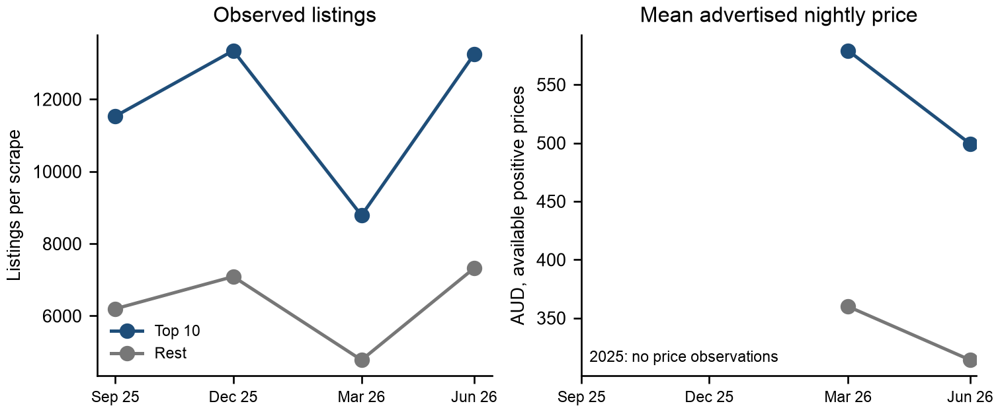

# Where Airbnb listings concentrate in Sydney

Python analysis of listing concentration, advertised prices and guest concerns in Sydney. The project compares the ten areas with the most listings against the rest of the city, then checks how the same groups change across four published data snapshots.

By Marvin Neumann. Supporting code for the Data Analytics and Big Data case study, Task 1 (`DLBINGDABD01_E`).



## Main findings

- The June 2026 dataset contains **20,573 listings across 38 areas**. The top ten hold **64.4%** of listings.
- Entire homes account for **85.3%** of listings in the top ten, compared with **66.8%** elsewhere.
- Listing counts are available for September and December 2025 and March and June 2026. **The 2025 files contain no prices.** The price comparison therefore uses only the two 2026 snapshots.
- Between March and June, the mean advertised nightly price falls from about **579 to 499 AUD** in the top ten and **360 to 314 AUD** elsewhere. A comparison restricted to the same listings gives smaller changes: **577 to 527 AUD** and **359 to 348 AUD**.
- The largest complaint themes concern facilities, cleanliness, beds, kitchen equipment and noise. Their percentages measure **topic weight**, not the percentage of guests who complained.

These findings identify places to investigate. They do not establish occupancy, lost long-term housing, rent increases or the effect of a regulation.

## Reproduce the analysis

All three analysis scripts were rerun on 30 September 2026. Every supplied aggregate result file matched the saved baseline byte for byte. All five input checksums were verified.

Tested with **Python 3.14.5**. The versions used are pinned in `requirements.txt`. Run the commands from this repository's root:

```bash
python3 -m venv .venv
.venv/bin/python -m pip install -r requirements.txt
.venv/bin/python fetch_data.py
.venv/bin/python analysis.py
.venv/bin/python historical_analysis.py
.venv/bin/python text_analysis.py
```

On Windows, use `.venv\Scripts\python.exe` instead of `.venv/bin/python`. No API key is needed. Data downloads and the sentence-level sentiment/topic analysis can take several minutes. Plotting uses Arial when installed; another system font may change chart appearance without changing the tables.

The downloader checks every input against its recorded SHA-256 hash. If an upstream file changes, it stops rather than silently using a different dataset. If a snapshot is no longer available, obtain that exact archived file from Inside Airbnb; do not substitute a newer snapshot. Already downloaded inputs can be checked without network access:

```bash
.venv/bin/python fetch_data.py --verify-only
```

## What each script does

| File | Purpose |
|---|---|
| `analysis.py` | June data preparation and the top-ten/rest comparison: room and property types, guest capacity, host portfolios and minimum stays. |
| `historical_analysis.py` | The final historical analysis: four listing counts, two price observations, missing-price rates and a matched-listing comparison. Run after `analysis.py`. |
| `text_analysis.py` | Sentence-level VADER sentiment, comparison of NMF and LDA topics, and grouped guest concerns. Run after `analysis.py`. |
| `fetch_data.py` | Download or verify the five original input files. |
| `data/sources.json` | Exact source URLs, snapshot dates, data licence and file checksums. |
| `results/` | Aggregate tables and provenance used to inspect the findings. |
| `figures/` | The four figures used in the report. |
| `REPRODUCIBILITY.json` | Checksums of the analysis scripts and supplied result tables. |

The three analysis scripts are unchanged copies of appendix A.1, A.2 and A.3 in the report. `analysis.py` also retains an earlier review-activity proxy and current-price-by-entry-cohort exploration. **Those outputs are superseded for the report's historical question by `historical_analysis.py`.** Its old "one snapshot" comment describes the earlier stage of the project, not the final data coverage.

For topic discovery, the executable setting is `N_TOPICS = 15`, with seed 42, followed by a fixed mapping from topics to concerns and selection of the five largest concerns. The older `fit_topics` docstring says `k=5`; the actual model fits 15 topics. The code is preserved to match the submitted appendix. The mapping is an analyst interpretation, not a learned ground-truth label set. NMF component ordering and small floating-point differences may vary on another software stack, so inspect the top terms before transferring that mapping to new data.

## Data and interpretation

Source: [Inside Airbnb, Get the Data](https://insideairbnb.com/get-the-data/), Sydney, Australia. Inside Airbnb publishes the data under [Creative Commons Attribution 4.0 International](https://creativecommons.org/licenses/by/4.0/). This project filters and aggregates those data and calculates derived statistics and figures. Inside Airbnb does not endorse this analysis.

The exact listing snapshots are **12 September 2025**, **12 December 2025**, **21 March 2026** and **16 June 2026**. The June publication folder is dated 16 June; the listing records' `last_scraped` dates run from **17 to 29 June**. The June review file supplies the text analysis. Source URLs and hashes are in `data/sources.json`.

The top-ten membership is fixed using June 2026 for all historical comparisons. Prices are advertised nightly AUD values, not realised revenue. Missing prices are not imputed. The historical price means use available positive prices; the matched comparison additionally requires a valid price in both 2026 snapshots and unchanged area-group membership.

The text analysis retains sufficiently long English-like reviews from 16 June 2025 onward. Negative sentences are selected with a VADER compound score of at most -0.30. It compares NMF on TF-IDF features with LDA on word counts, removes weak topic assignments, groups informative topics into concerns and normalises their weights. Public reviews can contain praise that VADER misreads as negative. Guest complaints are not a substitute for resident evidence.

## Scope of the public repository

Only code, source metadata, aggregate results and figures are included. Raw listing/review records, review-text examples, the manual validation sample, university task materials, tutor correspondence and the submission PDF are kept out of the repository. Running the scripts locally recreates intermediate outputs, including review-text examples; those files are ignored by Git.

The report remains the academic submission, with the required code appendix. This repository is an additional way to inspect and rerun the analysis.
